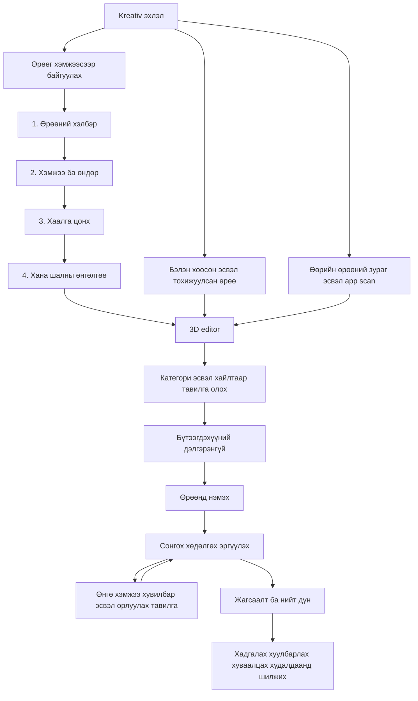
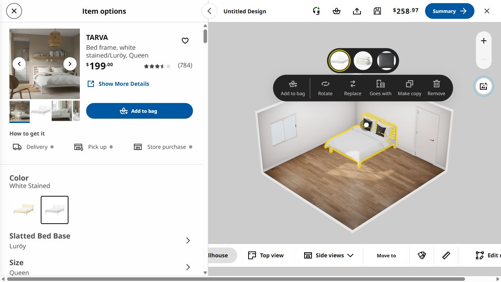
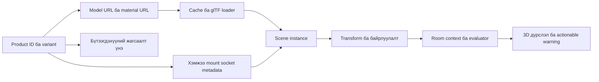
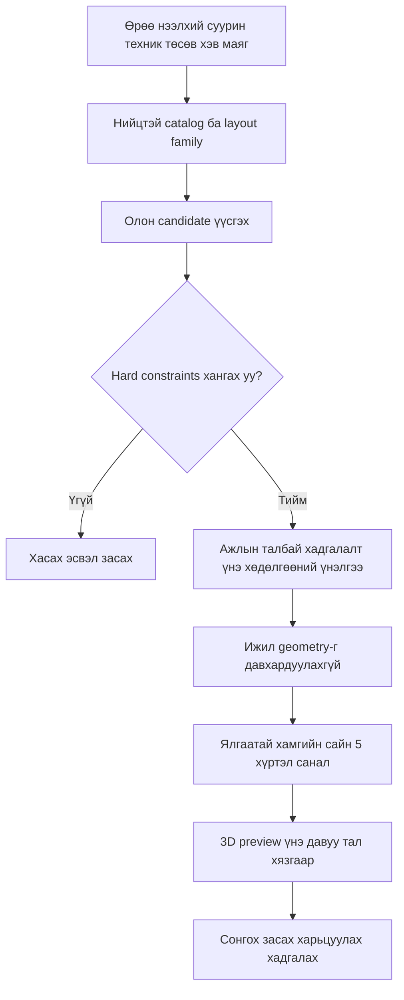

# IKEA Room Planner — гүнзгий судалгаа

Судалсан: 2026-10-20. US IKEA Kreativ веб, manual room builder, public frontend JavaScript болон IKEA-ийн албан ёсны тайлбарууд.

## Гол дүгнэлт

IKEA-ийн сайн туршлагын суурь нь **бодит бүтээгдэхүүний каталог + зөв хэмжээтэй 3D asset + байрлуулах дүрэм + контекстэд таарсан засварлах урсгал** юм. Зөвхөн AI зураг эсвэл тавилгын нэрээр model тааруулалт энэ чанарыг орлохгүй.

Kreativ ба Kitchen Planner тусдаа бүтээгдэхүүн. Доорх техникийн REA олдворууд нь Kreativ-д хамаарна. Kitchen Planner-ийн хэсгийг албан ёсны баримтаар тусад нь тайлбарлав. Kreativ-ийн renderer/placement implementation-ийг METOD-ийн exact implementation гэж ойлгож болохгүй.

**Баримтын тэмдэглэгээ:**

- **Шууд UI:** ажиллаж буй planner дээр харсан эсвэл туршсан.
- **REA source:** browser-аар хүрсэн public frontend source-оос тогтоосон; кодын бүх branch ажилласан гэсэн үг биш.
- **Албан ёсны:** IKEA-ийн нийтэлсэн help/newsroom баримт.
- **Манай санал:** олдвор дээр үндэслэсэн хэрэгжүүлэлтийн шийдэл; IKEA-ийн дотоод системийн баталгаа биш.

## 1. Хэрэглэгчийн ажлын урсгал

### Эхлэх сонголт

**Шууд UI:** landing дээр quick-start templates, build custom room, visualize products in your home гэсэн гурван entry байна. Template-ууд нь хоосон/тохижуулсан, өрөөний төрөл болон бүрэн/хэсэгчлэн тохижуулсан сонголттой. Өмнөх design-ийг code-оор нээх боломж харагдсан.

**Албан ёсны:** зураг ашиглах, LiDAR-enabled app-аар full-room scan хийх, вебээр хэмжээс оруулах, starter room сонгох замуудтай. Фото/scan урсгалыг энэ судалгаанд өөрийн зураг байршуулж туршаагүй. [IKEA getting started](https://www.ikea.com/us/en/customer-service/knowledge/articles/982f84a7-5941-45a8-a34a-1727c57dcc7f.html).

### Manual room builder-ийн дөрвөн алхам

| Алхам | Шууд харагдсан UI | Манай planner-д авах санаа |
|---|---|---|
| 1. Shape | Rectangular, L-Shape, Cut, T-Shape, U-Shape, Beveled | Хэрэглэгчээр polygon зурүүлэхээс өмнө ойлгомжтой template өг |
| 2. Dimensions | Хана/өрөөний хэмжээ, floor-to-ceiling өндөр, cm эсвэл ft/in, flip, 90° rotate | Нэгж ба өндөрийг ил тод болго; хэмжээ оруулахтай preview-г холбо |
| 3. Doors/windows | Хаалга/цонхны төрөл, хэмжээ, Customize, Remove | Нээлхийг тавилгаас өмнө бүртгэж, байрлуулахад саад болго |
| 4. Finishes | Ханын swatch, шалны материал, Design this room | Geometry тохируулга ба өнгөлгөөг тусдаа алхам болго |

Дөрвөн алхмыг REA scenario-оор нэвтэрсэн. Хана чирж хэмжээ өөрчлөх, хаалга resize хийх, төгсгөлийн Design this room үйлдлийг энэ scenario-д туршаагүй.

### Editor доторх бодит туршилт

1. Neutral standard template нээсэн; Add/List/Favorites panel, хайлт, category, Auto hide харагдсан.
2. Bedroom каталогийн TARVA бүтээгдэхүүний details нээсэн. Үнэ, хэмжээ, зураг, үнэлгээ, SKU link, availability, Add to room болон Add to bag тусдаа байсан.
3. **Add to room** дарж ор нэмсэн. Pillow/duvet нь тусдаа customization/purchase байж болох тухай notification гарсан. Нэг харагдах объект ба худалдан авах бүрдэл заавал нэг SKU биш гэдгийг энэ харуулна.
4. 3D дээр ор сонгоход Item options болон ойролцоох action toolbar гарсан: rotate, replace, goes with, make copy, remove, add to bag.
5. TARVA-ийн pine → white stained өнгийг сольсон. Product description болон бүтээгдэхүүний link өөр SKU болж шинэчлэгдсэн. Иймд энэ үйлдэл зөвхөн дурын RGB өнгө солих биш, бодит catalog variant сонголттой холбоотой.
6. Color, Slatted Bed Base, Size тусдаа тохиргоо; Swap with similar ба Goes well with тусдаа tab байв.

Screenshot дахь шар outline нь IKEA-ийн сонгосон объектын highlight. Манай planner-ийн өмнөх generated yellow cabinet-тэй холбоогүй.

Save/share/cart интерфэйсийг харсан; account login, cloud save, share publication, захиалга хийгээгүй. Swap-in-place, duplicate болон mount type-оос хамаарах action-уудыг [IKEA action panel help](https://www.ikea.com/us/en/customer-service/knowledge/articles/947c11dc-0346-4cb6-ade0-ba6972b2d8bc.html) давхар тайлбарладаг.

## 2. Furniture сан нь ямар бүтэцтэй байна вэ?

**REA source:** normalized product нь дараах хэд хэдэн төрлийн мэдээллийг хамтад нь авч явдаг.

| Давхарга | Source-д харагдсан талбар/ойлголт | Яагаад хэрэгтэй вэ? |
|---|---|---|
| Худалдааны identity | id, globalProductId, localItemNumber, region, price, ecommerceUrl, availableInRegion | Model, variant, үнэ, бүтээгдэхүүний жагсаалт хоорондын холбоо |
| Каталог | collections, rootCategories, categoryIds, subCategories | Browse, хайлт, өрөөний төрөлд тохирсон санал |
| 3D | renderType, modelUrl, materialUrl, scale, rotX, min/max, productGeometries | Asset-ийн orientation, хэмжээ, материал, geometry сонголт |
| Байрлуулах зан төлөв | requiresWallContact, stacks, stackables, placeables, isSnapRotable | Хана, шал, дэмжих гадаргуутай зөв харьцах |
| Угсралт | sockets, plugs, combinablesMetadata, default products, configurationData | Нийцтэй хэсгүүдээр бүрдэл угсрах |
| Харилцан санал | swappableItems, goesWithItems | Орлуулах ба хамт хэрэглэх эдлэлийг ялгах |

Энэ нь frontend contract; IKEA-ийн database schema-г сэргээсэн гэсэн үг биш.

### Каталогийн үйлчилгээ тусдаа үүрэгтэй

Public source-д request construction нь дараах замуудыг ялгасан:

- `/furniture/`, `/furniture/search/`, `/furniture/search-category/`: category/room/region, query, pagination, stock/availability болон geometry filters.
- Exact ID эсвэл local item number lookup: scene дахь эдлэлийг каталогийн бодит бүтээгдэхүүнтэй холбоно.
- `/{id}/variants/`: нэг бүтээгдэхүүний өнгө/хэмжээ зэрэг хувилбар; composable child-д socket size/category-аар compatibility шүүнэ.
- `/{id}/swappables/`: орлуулж болох өөр бүтээгдэхүүн; variant-уудыг тусад нь хасах option байна.
- `/{id}/recommendations/`: хамт хэрэглэх эдлэл.
- `/adv_recommendations/`: `{room_type, nbr_of_items:3, current_items}` хэлбэрийн request body харагдсан.

Эдгээр бүх endpoint-ийг шууд дуудаагүй. Request source байгаа нь backend ranking нь ML, constraint search эсвэл өөр арга гэдгийг батлахгүй. `nbr_of_items:3` нь гурван бүхэл room layout гэсэн утгатай гэж дүгнэж болохгүй.

## 3. 3D model, өнгө, угсралт яаж ажиллаж байна вэ?

### Батлагдсан frontend механизм

**REA source:**

1. glTF scene ачаалах **GLTFLoader** ашиглаж, **DRACOLoader** холбоод decoder тохируулдаг. Бүх model Draco-compressed гэсэн баталгаа биш.
2. URL-аар model cache хадгална. Ижил asset зэрэг шаардвал in-flight promise хуваалцана.
3. Scene instance-д cached model-ийн deep copy ашиглана; reference count, release/dispose байна.
4. Render readiness хүлээсний дараа model configuration хийнэ.
5. Material setup-д environment map/intensity, cast/receive shadow, transparency/depthWrite, texture anisotropy, bounds орно.
6. Variant нь `productId`, `valueKey`, `thumbUrl`-тай. Хуучин/шинэ item хоёулаа material reference-тэй branch-д material swap, бусад branch-д full furniture swap сонгоно.
7. Зарим угсрах эдлэл socket category/size болон parent metadata-аас dynamic geometry сонгоно; тохироогүйд simple geometry fallback байна.
8. Configuration branch олон asset URI ачаалж нийлмэл model угсрах боломжтой.

### Юуг тогтоогоогүй вэ?

CAD/artist source-ийг яг ямар програмаар хийдэг, retopology/baking pipeline, texture resolution, polygon/LOD budgets, бүх asset-ийн format, backend conversion worker-ийг энэ судалгаа тогтоогоогүй. Public frontend loader-оос эдгээрийг батлах боломжгүй. “AI тавилгын mesh-ийг шинээр үүсгэдэг” гэсэн нотолгоо олдоогүй.

**Манай санал:** үйлдвэрлэгчийн бодит хэмжээс → чанартай source model → orientation/pivot/scale normalization → material ба texture optimization → glTF export → bounds/mount/socket metadata → validation → versioned catalog publish гэсэн asset pipeline хэрэгтэй. Энэ бол санал болгож буй pipeline, IKEA-ийн дотоод pipeline-ийн хуулбар биш.

## 4. Байрлуулалтын ухаалаг байдал

**REA source:** `ON_WALL`, `ON_FLOOR`, `WALL_OR_FLOOR`, `WALL_AND_FLOOR`, `WALL_AND_FLOOR_CORNER` behavior-уудыг ялгасан classifier байна. Source-ийн импортлосон predicate бүрийг бүрэн тайлж тогтоогоогүй тул яг ямар field аль behavior сонгуулдгийг бүх тохиолдолд батлаагүй.

Evaluator нь room context, product metadata, render instance/collision state-ийг нийлүүлдэг. Loading/placement pending үед үнэлгээг хүлээлгэнэ; зарим child болон noninteractable item-ийг тусдаа excluded болгоно. Issue төрлүүдэд:

- хана хүрэх шаардлага;
- өрөөнөөс өндөр бүтээгдэхүүн;
- хаалга/цонхтой давхцах;
- хэт өргөн бүтээгдэхүүн орно.

Warning/tip нь select item, edit room, customize product зэрэг засах үйлдэлтэй холбогдоно. Exact collision formula, tolerance, clearance-ийг бүрэн сэргээгээгүй.

**Манай дээд/доод шүүгээний асуудалд:** model-ийн нэр эсвэл харагдах байдлаар role тааруулахгүй. `category + mount + width/depth/height + asset compatibility`-г заавал тааруул. Wall cabinet-ийг base cabinet-ийн fallback болгон авахыг хоригло. Asset байхгүй тохиолдолд худал model үзүүлэхийн оронд тухайн item-ийн бэлэн бус төлөвийг ойлгомжтой харуул.

## 5. AI хэрэгтэй юу?

**Албан ёсны:** IKEA-ийн launch тайлбарт indoor objects/geometry recognition, neural networks, stereo vision, computational photography, furniture erase нэрлэсэн. Энэ нь фото өрөөг ойлгох талын AI нотолгоо. [IKEA newsroom](https://www.ikea.com/us/en/newsroom/corporate-news/ikea-launches-new-ai-powered-digital-experience-empowering-customers-to-create-lifelike-room-designs-pub58c94890/).

**REA source:** starter-set loading/placing, automatic placement status, unsupported-product fallback болон recommendation API байна. Гэхдээ автоматаар шилдэг 5 бүхэл зохион байгуулалт гаргах exact algorithm, training dataset, model architecture тодорхойгүй.

**Манай санал:** эхлээд constraint-тай candidate generation ба ranking хангалттай. ML-ийг дараа нь хэрэглэгчийн сонголт/редакт/хадгалалт зэрэг чанартай feedback цугларсан үед reranking, style preference, зураг танихад ашиглаж болно. Дээд шүүгээ доор ордог алдааг ML-ээр дарах шаардлагагүй — typed data ба placement constraint-аар шийднэ.

## 6. Kitchen Planner-ийн тусдаа урсгал

Албан ёсны METOD тайлбарын дагуу: хэмжээсээ бэлдэх → oven/hood/fridge/layout сонгох эсвэл room definition рүү шууд орох → ойролцоо room shape → хэмжээс → Customize дээр cabinets/appliances/accessories → cabinet opening direction/нээлтийг шалгах. [IKEA METOD planner help](https://www.ikea.com/de/en/customer-service/knowledge/articles/f4aa1b4f-d00d-4413-92ad-fa12de7d0977.html).

Энэ specialized planner-ийг энэ судалгаанд runtime-аар бүхэлд нь нэвтрээгүй. Kreativ-ийн room workflow-ийг авсаар kitchen-д үйлчилгээний цэг, суурин техник, worktop, door swing, cabinet dependencies, parts list гэсэн нэмэлт domain rules хэрэгтэй гэж үзэж байна.

## 7. Манай planner-д хэрэгжүүлэх дараалал

| Эрэмбэ | Ажил | Дууссаны шалгуур |
|---|---|---|
| 1 | Каталог ба model contract цэгцлэх | Role/mount/хэмжээ зөрсөн asset scene рүү орохгүй; SKU ба variant тодорхой |
| 2 | Placement engine | Шал/хана/өндөр, corner, supports, opening collision шалгалт; алдаанд засах үйлдэл |
| 3 | Asset ба renderer | Зөв pivot/scale, чанартай материал, тогтвортой light/shadow, cache, loading readiness |
| 4 | Editor UX | Сонгосон item-ийн panel, ижил байрлалд swap, duplicate, undo/redo, top/side view, хэмжээс |
| 5 | Таван санал | Зөв geometry дээр олон candidate үүсгэж, hard constraints-аар шүүж, ялгаатайг rank хийх |

### Таван саналын санал болгож буй урсгал

Хэрэглэгчид таван зураг харагдахаас илүү **яагаад энэ санал тохирсон**, **нөгөөгөөс юугаараа ялгаатай**, **хэдэн төгрөг**, **ямар хязгаарлалтад орсон** гэдгийг ойлгуулах хэрэгтэй. Valid candidate хүрэлцэхгүй бол 5 болгож давтахгүй. Дутуу constraint-ыг нэрлэж, боломжит сонголтыг харуулна.

Саналын зорилгыг: тэнцвэртэй, төсөв хэмнэсэн, хадгалалт ихтэй, ажлын талбай ихтэй, хөдөлгөөн чөлөөтэй гэж ялгаж болно. Энэ ангилал бол манай бүтээгдэхүүний санал; IKEA-ийн exact таван сонголт биш.

## 8. Баримтын индекс ба хязгаар

| Баримт | REA evidence ID | Хамрах хүрээ |
|---|---|---|
| Landing runtime scenario | ev_c82506f5761ca04bf71ccf205dcf94eae33c1a4de5cac96c35057c6636f25b72 | Entry, templates, UI/DOM, network metadata; body/event budget бүрэн биш |
| Builder runtime scenario | ev_8b94fc5fb69035431629f24b9511d117ade9d269d513613fe77aa4324b9b9537 | Дөрвөн setup step; property edit бүрийг туршаагүй |
| Editor passive capture | ev_67d9f6277d78afd5f40be2abac2e0acf7f7523b030358793f562f129daa3b1bd | Live page, public script source; бүх source branch executed биш |
| Editor source export | ev_36cc9c9b8c23868c579ed8744bb46df4ca14601bf1a4c42b207127ba8b7b5332 | 157 script exported, 1 unavailable; hashes manifest-д |
| Focused static analysis | ev_0378a83a3686df05db660ddac14a8eb10a7572e9b9ed304bf1df5664a43921b1 | Эхний 4 exact source, partial graph; нэмэлт том chunk-уудыг targeted text-аар уншсан |

Editor-ийн TARVA add/select/color swap нь тусдаа CUA UI туршилт; REA scenario гэж тэмдэглээгүй. Screenshot ба AX snapshot хадгалсан. Network/source archive нь тухайн өдрийн public site-ийн snapshot, ирээдүйн хувилбарт өөрчлөгдөж болно. Benchmark FPS, memory, бүх төхөөрөмжийн performance-ийг хэмжээгүй тул smoothness-ийн тоон амлалт өгөхгүй.

Хавсралт:

- [Static source тайлбар, exact file ба offset](./ikea-static-catalog-2026-10-20.md)
- [Албан ёсны эх сурвалжийн тэмдэглэл](./ikea-official-sources-2026-10-20.md)
- [REA evidence bundle](./ikea-2026-10-20-evidence.json)
- [Editor source manifest](./ikea-editor-scripts-2026-10-20/manifest.json)
- [UI accessibility snapshot](./ikea-item-options-ax-2026-10-20.txt)

Энэ удаа судалгааны artifact-ууд нэмсэн; planner-ийн application code-д өөрчлөлт хийгээгүй.

Дараагийн хэрэгжүүлэлт: [2026-10-20 planner-ийн код, шалгалт ба каталогийн үлдсэн хязгаар](./ikea-planner-implementation-2026-10-20.md).
