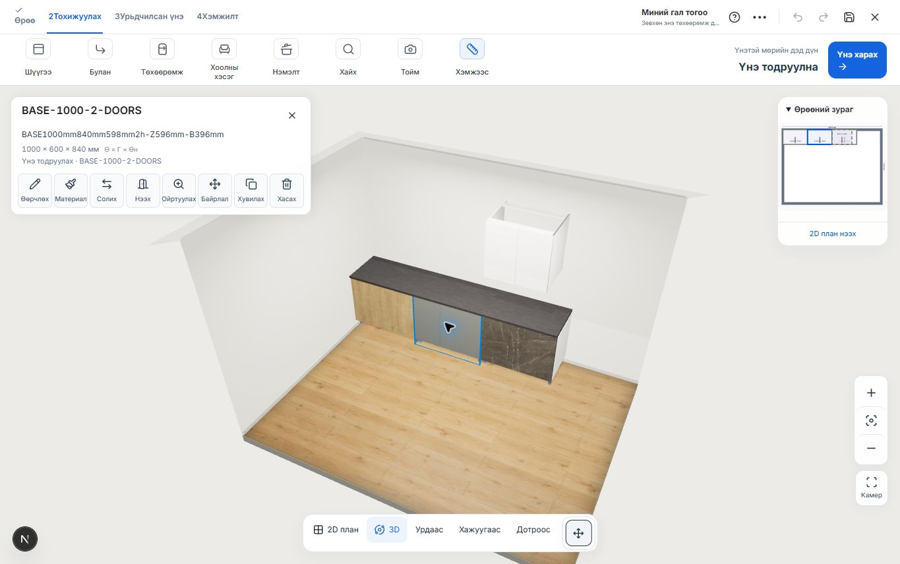

# Бокс сонгоход 3D зураг алга болох засвар

2026-10-24, local хувилбар.

Сонгосон боксын overview самбар desktop дээр нээгдэхэд өмнөх CSS `0px 1fr` гэсэн хоёр баганатай grid үүсгэж байв. Камер тогтворжуулах CSS нь workspace-ийг эхний, 0 өргөнтэй баганад байрлуулсан тул 3D өрөө болон удирдлага алга болсон. JavaScript exception гараагүй.

3D layout одоо үргэлж `0 minmax(0, 1fr)` баганатай, workspace нь хоёр дахь баганад байна. Floating самбарууд хоёр баганыг бүхэлд нь хамарна. Overview-ийн дүрэм түрүүлж эсвэл сүүлд ачаалагдахаас хамаарахгүй ижил grid байрлалтай.

Chrome дээр 1365×855 viewport-д:

- Засахаас өмнө: бокс сонгосон үед workspace/canvas-ийн CSS өргөн **0**.
- Засварын дараа: бокс сонгох, өөр доод бокс руу шилжих, дээд бокс сонгох, материалын самбар нээхэд canvas **1365×725** хэвээр.
- Хуудсыг шинээр ачаалаад 3D дээр бокс шууд дарж сонгоход зураг хэвээр; console error байхгүй.
- Төслийн байрлал, материал өөрчлөөгүй.

Шалгалт: холбогдох 21 тест PASS; production build PASS. Нийтэд deploy хийгээгүй.

