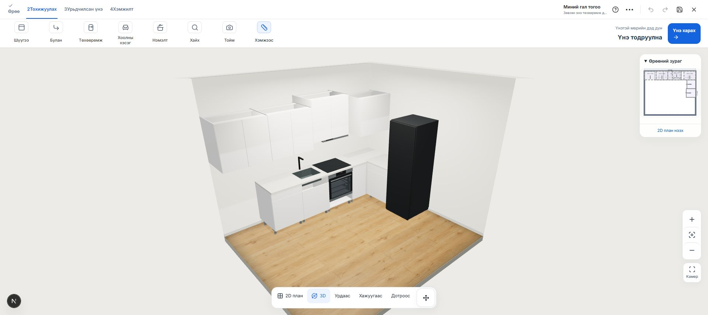
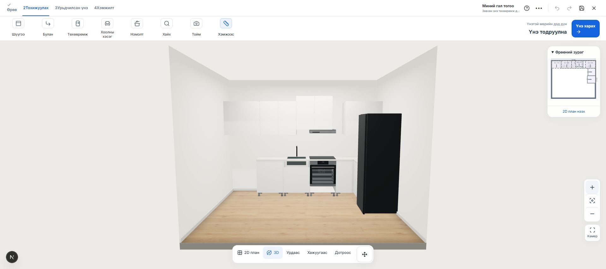

# Жишиг гал тогоог сангийн box, төхөөрөмжөөр солих

2026-10-25. Хэрэглэгчийн сонголт: өрөө, байрлалын хэлбэрийг хадгалж, хоосон хүрээтэй жишиг box ба хуучин төхөөрөмжийн дүрслэлийг байгаа 3D сангаар солих.

## Өөрчлөлт

- Каталогийн бэлэн GLB-үүдээс шүүгээний төрөл, өргөн, өндөр, гүнээр ойролцоо бүтээгдэхүүнийг сонгоно. GLB-г сунгахгүй; шүүгээний мэдээлэл тухайн SKU-ийн бодит хэмжээг авна.
- Ханын дагуух байрлал, эргэлт, өрөөний хэмжээ, ID-ууд хадгалагдана. Өргөн 800 мм-ийн дээд box-д зай гаргахдаа давхцлыг шалгана. Сорогчийн дээр болон хөргөгчийн дээр box багтах бол таазны хэмжээнд тааруулан өргөнө. Багтахгүй нэмэлт жишиг дээд box-ийг хасвал хэрэглэгчид мэдэгдэнэ. Өмнө нь сонгосон SKU-г зайгүй үед чимээгүй устгахгүй.
- Угаалтуурын box: сангийн хаалгатай бодит их биеийг ашиглаж, угаалтуурын эзлэхүүнд саад болсон дээд шургуулганы нүүр/дотор хавтанг салгана. Доод хаалга нээгдэх боломжтой хэвээр.
- Зуухны box: сангийн 600 мм их биеийн хажуу, ёроол, хөлийг хэвээр ашиглаж, зуухны нүхэнд саад болсон тусдаа нүүр, тавиур, арын хавтанг салгана. Hansa BOEI697688 GLB-г тавцангийн доор байрлуулна. Зуухны корпус 560 мм өргөн, урд хүрээ 595 мм хэвээр тул 600 мм box-ийн дотор таарна.
- Плитка: Hansa BHC60066 GLB. Тавцангийн нүхийг дүрслэлийн бодит доод корпусыг багтаах хэмжээнд гаргана. Энэ нь үйлдвэрлэгчийн суурилуулалтын зураг биш.
- Сорогч: Hansa OSP6111SIH · 598 × 470 × 85 мм. Плитканы төв дээр хананд таарна. Box нь дээр нь байрласан үед төхөөрөмжтэй давхцахгүй.
- Хөргөгч: Samsung RR80H39C1FWT · 595 × 644 × 1858 мм. Санд буй төхөөрөмжийн гадна хэмжээг дур мэдэн сунгахгүй.
- Жинхэнэ GLB нь байгаа төхөөрөмжид “3D загвар бэлэн биш” гэсэн буруу мэдэгдэл гаргахгүй. Тохируулсан box-уудыг угаалтуурын/зуухны box гэж ялгана. BOM-д PC Mall төхөөрөмжүүдийг тусад нь, давхар тоолохгүй оруулна; баталгаагүй үнийг 0 төгрөг гэж нийлбэрлэхгүй.

## Ашиглах

Шинэ үүссэн, бүтээгдэхүүн сонгоогүй жишиг төслүүд каталог ачаалахад бодит сангаар бүрдэнэ. Өмнө хадгалсан, бүтээгдэхүүн сонгосон төсөл автоматаар солигдохгүй.

Одоо байгаа төслийн **••• → Сангийн box, төхөөрөмжөөр солих** үйлдлээр байрлалд дахин тааруулна. Тохирох загваргүй хүрээ харагдсан үед мөн энэ товч бий. Үйлдлийг Undo-оор буцаах боломжтой.

Хэрэглэгчийн локал `256452f8-7ac5-4df1-9cd7-69c71ef085ef` draft-ийн L байрлалтай 11 хэсэгт хэрэглэж шалгасан.

## Хязгаар

Угаалтуур, крантын тусдаа GLB одоогийн каталогийн asset жагсаалтад байхгүй. Тиймээс тэдгээрийн төлөвлөлтийн 3D дүрслэлийг бодит box, тавцангийн нүхтэй хослуулан хадгалсан. Төхөөрөмжүүд нь өмнө үүсгэсэн хэмжээтэй төлөвлөлтийн GLB-үүд бөгөөд үйлдвэрлэгчийн албан CAD биш. Салгасан box-ийн хавтангуудыг BOM дахь зориулалтын нэрээр ялгана; үйлдвэр угсралтын нарийвчилсан хийцийг баталгаажуулах шаардлагатай.

Шинэ төхөөрөмжийн GLB-үүд: `public/models/pcmall/quality-v3/`. Өмнөх хувилбарын файлууд хадгалагдана. Өгөгдлийн сан, production орчинд өөрчлөлт оруулаагүй.

## Шалгалтын баримт

- Бүх 1,130 тест тэнцсэн: `catalog-furnishing-tests-2026-10-25.log`.
- Зориулалтын болон хаалга/эд ангийн тест: `catalog-furnishing-final-focused-2026-10-25.log`.
- L, урт шулуун байрлал, SKU хэмжээ, undo-д үлдэх эх загвар, хадгалж унших, сорогчийн төвлөрөл, BOM, дотор хийцийн саадтай хавтангуудыг тусад нь шалгасан.
- ESLint тэнцсэн: `catalog-furnishing-lint-2026-10-25.log`.
- Production build тэнцсэн (exit 0, typecheck багтсан): `catalog-furnishing-build-2026-10-25.log`.

