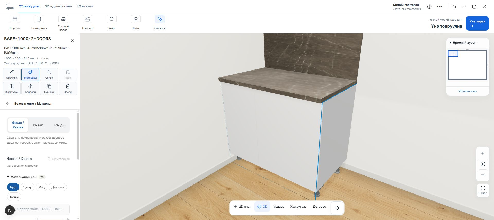
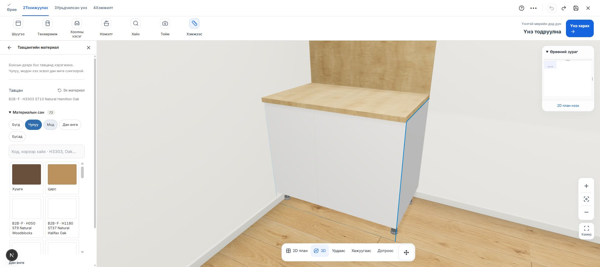

# Тавцангийн тусдаа материалын бүлэг — 2026-10-24

Боксын дээрх тавцанг фасад, их биеэс тусад нь сонгож, чулуу, модон хээ болон дан өнгөөр солих боломж нэмэв.

Хэрэглэх: 3D зурагт тавцан дээр шууд дарна. Эсвэл бокс сонгоод **Материал → Тавцан** нээнэ. **Чулуу / Мод / Дан өнгө** бүлгээс материалын зураг дарж сонгоно. Бүлэг солиход өмнөх хайлт цэвэрлэгдэнэ. Өөрийн HEX өнгө мөн шууд хэрэгжинэ.

Одоогийн төслийн бүх тавцан нэг нийтлэг материалтай. Ханын арын хавтан нь өмнөх загварын адил тавцангийн материалыг дагана. Материал солих нь фасад, их бие, байрлал, хэмжээс, угаалтуур/плитканы нүхийг өөрчлөхгүй. Хуучин worktop component-ийн өнгөний override шинэ сонголтыг дарахгүйгээр шинэчлэгдэнэ.

3D тавцанг `top:<cabinetIds>` нэртэй тусдаа group болгон, шууд дарахад материалын цэс нээгддэг болгов. Каталогийн baseColor / normal / roughness / metalness зураг байгаа тохиолдолд generated тавцан болон ханын арын хавтанд ашиглана. Дан өнгө сонгоход хуучин texture арилна. Зургийн сангийн texture pool-ийг ашиглаж, хэрэглээ дуусахад release хийнэ.

Материалын бүлэг нь хээний төрлийг ангилна; хавтангийн үйлдвэрлэлийн бүтэц, байгалийн чулуу эсэхийг батлахгүй.

Баталгаажуулалт:

- 1078/1078 тест амжилттай; шинэ дөрвөн тест нь бүлэглэлт, хадгалалт, component override, бодит renderer-ийн texture map, нүх болон тусдаа сонголтыг шалгасан.
- TypeScript болон өөрчилсөн TS/TSX файлуудын ESLint амжилттай.
- Production build амжилттай. Эхний sandbox build Google Fonts сүлжээний хоригтой байсан; сүлжээтэй build амжилттай дууссан.
- Бодит 1000 мм GLB дээр F205 ST9 чулуун хээ, H3303 ST10 модон хээ, хар дан өнгө болон Undo-г browser-оор шалгасан.
- Дахин нээсний дараа H3303 сонголт хадгалагдсан. 3D тавцан дээр шууд дарж цэс нээх ажиллагаа батлагдсан.
- Browser console алдаагүй, desktop дээр хөндлөн халилтгүй.

Тусдаа QA draft: `bc242026-1024-4000-8000-000000000031`. Хэрэглэгчийн ажиллаж байсан draft-д материалын туршилт хийгээгүй.

Өөрчлөлт localhost дээр. Commit, push, production deployment хийгээгүй.
