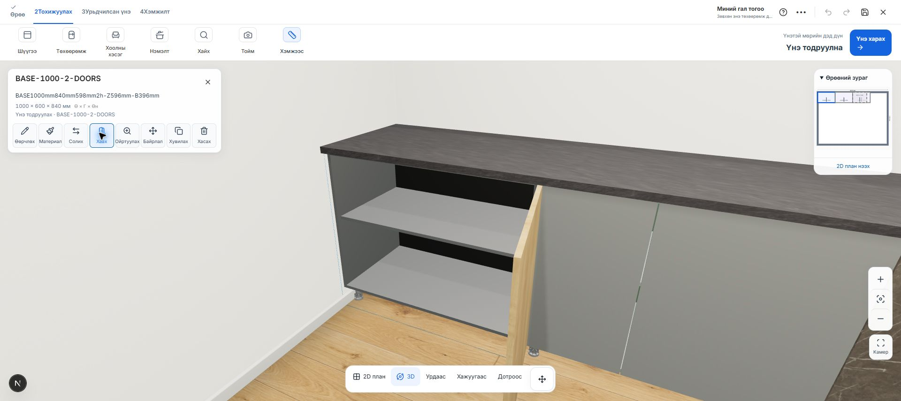
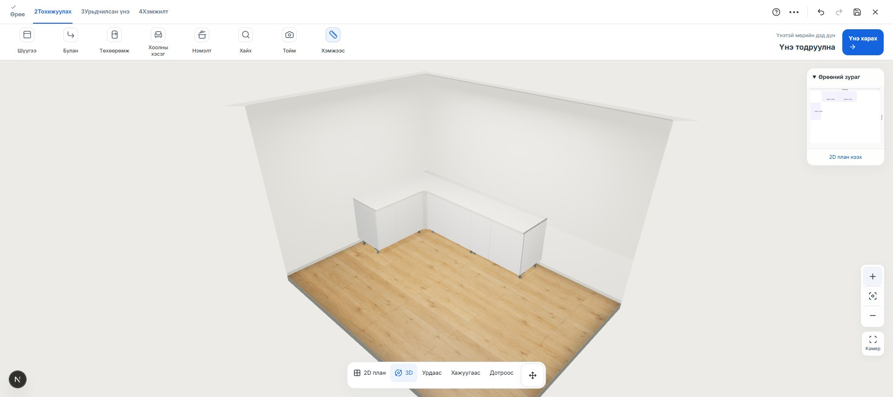
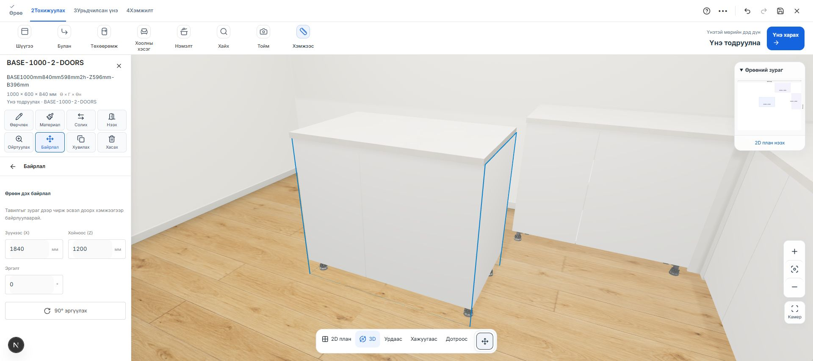
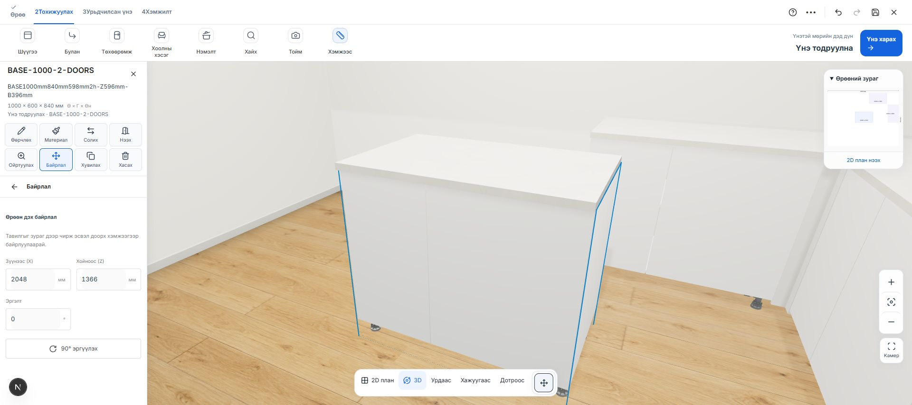

# Гал тогооны хаалга, булан, камер

Хийсэн: 2026-10-24. Local хөгжүүлэлтийн хувилбар; нийтэд deploy хийгээгүй.

## 1. Хаалга

- BASE1000 ба WALL800 GLB-ийн байгаа хаалгануудыг гадна ирмэгийн нугасаар 90° нээж, буцааж хаана.
- Шүүгээ сонгоод **Нээх / Хаах** дарна. Бариул хаалгаа дагана; их бие, тавиур, хөл хөдөлгөөнгүй.
- Кэшлэгдсэн эх GLB болон хаалттай үеийн geometry өөрчлөгдөхгүй. Салангид нүүргүй бүхэл mesh-д зохиомол хаалга үүсгэхгүй.

## 2. Булан

- Toolbar → **Булан** → зүүн / баруун тал → арын ханын шүүгээний тоо → зай → **L булангаар байрлуулах**.
- Хоёроос доошгүй доод шүүгээ шаардлагатай. Каталогт тусгай булангийн GLB байхгүй тул хоосон булан, хоёр зайны хавтан, буланг бүрхсэн тавцангаар шийдсэн.
- Үндсэн зай 60 мм. Боксын бодит хэмжээ, ID, материал хадгалагдана. Дээд шүүгээнүүд өмнөх доод шүүгээнийхээ шинэ байрлалыг дагана.
- Хэтэрсэн хэмжээ, давхцалтай байрлалыг хэрэгжүүлэхгүй. Хэрэгжүүлэхэд салгасан тавцанг бокст тааруулах горимд буцаана.
- Булангийн зайны хавтан болон тавцан материалын тооцоонд орно. Хажуугийн боксыг гараар холдуулбал агаарт үлдсэн хавтан, булангийн нөхөөс харагдахгүй.
- Энэ нь булан дотор хадгалах механизмтай тусгай шүүгээ биш; хаалттай хоосон булангийн шийдэл.

## 3. Камер, зөөх

- 3D зураг бүх өргөнөө хадгалж, каталог ба тохиргооны самбар дээр нь нээгдэнэ. Самбарын overview/detail солигдох, сонгох, зөөх үед canvas хэмжээ өөрчлөгдөхгүй.
- Камерын анхны target-ийг нэг удаа тохируулна. Дахин render хийхэд хэрэглэгчийн харах төвийг буцааж солихгүй.
- Шүүгээ зөөж эхлэхэд камерын transition болон үлдэгдэл inertia зогсоно. Зөөж байх үед cursor navigation ажиллахгүй.
- Ханын далдлах заагт жижиг hysteresis нэмсэн; шүүгээ зөөж байх хугацаанд далдлах тал нь өөрчлөгдөхгүй. Ханын бодит сүүдэр хэвээр.

## Шалгалт

- Бүх тест: **1092 / 1092 PASS**. `kitchen-doors-corners-camera-tests-2026-10-24.log`.
- ESLint, TypeScript: PASS. Production build: PASS.
- Шинэ interaction CSS-ийн syntax, selector, canonical formatting: PASS. Repository-ийн нийт `styles:check` өмнөх олон CSS файлын formatting дээр унана; тэдгээрт бөөн формат өөрчлөлт хийгээгүй.
- Chrome дээр доод, дээд GLB хаалга нээх/хаах; зүүн, баруун L булан; бодит чирэх үйлдэл шалгасан.
- 1920×855 browser viewport-д canvas rect самбар хаалттай, булангийн самбар нээлттэй, байрлалын самбар нээлттэй, зөөсний дараа бүгд `x=0, y=130, width=1920, height=725`.
- Чөлөөтэй шүүгээг чирэхэд `(1840,1200)` → `(2048,1366)` мм болж, хананы харагдац хэвээр үлдсэн. Давхцсан байрлалын оролдлогыг буцаадаг.
- Хэрэглэгчийн үндсэн төслийн байрлалыг өөрчлөөгүй. L булангийн жишээг тусдаа local draft дээр үүсгэсэн.

Зураг:

