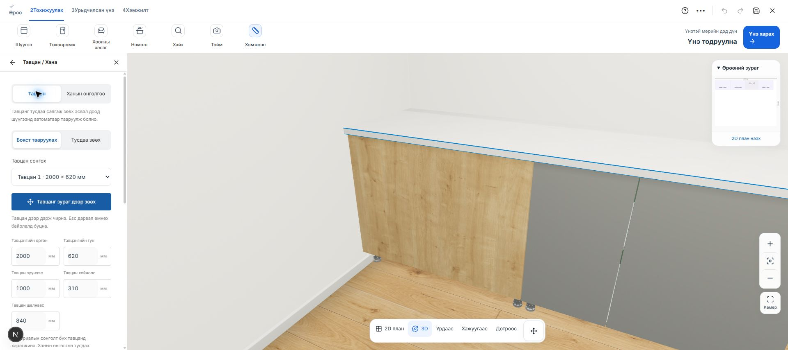
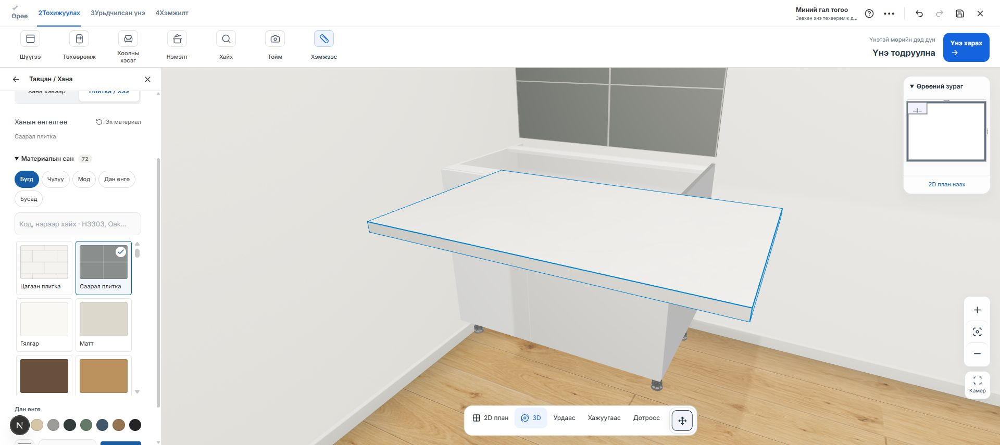

# Тусдаа зөөдөг тавцан, бие даасан ханын өнгөлгөө — 2026-10-24

Хэрэглэгчийн хүсэлт: тавцанг боксоос тусдаа салгаж зөөх; арын дээш босоо тавцангийн хавтанг арилгах; ханын будаг/обой хэвээр үлдэх эсвэл тусдаа плитка сонгох.

Хэрэгжүүлсэн:

- Тавцангийн цэсэнд **Тусдаа зөөх / Бокст тааруулах** горим, тавцан сонгох жагсаалт, өргөн/гүн болон X/Z/шалнаас өндрийн тохиргоо нэмсэн.
- **Тавцанг зураг дээр зөөх** дарж 3D тавцанг чирэхэд кабинет хөдөлдөггүй. Pointer capture, Esc болон цуцлах үйлдэл нь одоогийн drag pipeline-ийг ашиглана. Чирэх үед самбарын өргөн хадгалагдаж камер үсрэхээс сэргийлнэ.
- `countertopLayout` JSON-д тавцан бүрийн байрлал, хэмжээ, материал хадгалагдана. Бокст буцааж тааруулахад автомат run-based geometry сэргэнэ.
- Угаалтуур, плитканы нүхний байрлалыг хавтантай хамт зөөдөг anchor хадгалсан. Хэмжээ/байрлал буруу, өрөөний гадна, шүүгээ эсвэл өөр тавцантай огтлолцсон өөрчлөлтийг хадгалахгүй.
- Шинэ гал тогоонд босоо хавтан автоматаар үүсэхгүй. Хуучин төслүүдийн илэрхий сонгосон backsplash-ийг дэмжсэн хэвээр; хэрэглэгчийн нээлттэй дөрвөн бокстой төсөлд **Хана хэвээр** сонгож босоо хавтанг арилгасан.
- **Ханын өнгөлгөө → Хана хэвээр / Плитка / Хээ** нь тавцангаас тусдаа материалтай. Цагаан, саарал плитканы SVG texture нэмсэн. Өнгө, бусад хээ мөн тусдаа сонгогдоно.
- Тавцанг салгаж зөөхөд ханын плитка шүүгээний арын ханан дээр байрандаа үлдэнэ. BOM дахь ханын материал тусдаа кодтой болсон.

Browser баталгаа:

- Тусдаа QA draft `fa242026-1024-4000-8000-000000000043` дээр бодит 1000 мм GLB ашигласан.
- 3D дээр чирэхэд тавцангийн төв `(500, 310)` → `(813, 913)` мм болсон; кабинет өөрчлөгдөөгүй.
- Саарал плитка хананд тусдаа гарсан; тавцан салсан хэвээр байсан.
- Reload дараа `(813, 913)` мм болон плитканы сонголт хадгалагдсан.
- Бокст тааруулахад `(500, 310)` мм сэргэсэн. Undo → `913`, Redo → `310` мм Z утга зөв болсон.
- Хэрэглэгчийн үндсэн draft `e4245a35-1000-4000-8000-000000000024` дээр босоо хавтан арилсан, материал, кабинетийн байрлал хадгалагдсан. Ханын тохиргоо **Хана хэвээр** гэж батлагдсан.
- Browser console алдаагүй, desktop хөндлөн халилтгүй.

Баталгаажуулалт: 1085/1085 тест; TypeScript, өөрчилсөн файлуудын ESLint болон production build амжилттай. Байрлал/нүх/хадгалалт/материалын тусгаарлалтыг шалгах таван шинэ тест нэмсэн.

Өөрчлөлт localhost дээр; commit, push, production deployment хийгээгүй. Материал солих нь одоогоор бүх тавцанд хэрэгжинэ; байрлал, хэмжээг тавцан бүрээр тохируулна.
