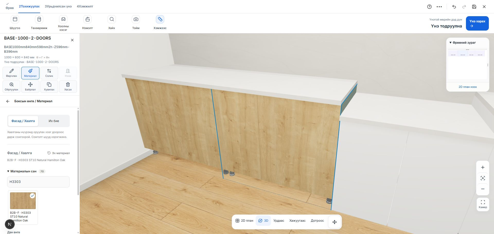

# Хавтангийн хээ сонгох цэс — 2026-10-24

Хэрэглэгч хавтангийн texture-ийг өөрөө солиход хүндрэлтэй байгааг мэдээлсэн. Нээлттэй localhost төслийн дөрвөн боксын нэг дээр шалгав: их биеийн ногоон өнгө хадгалагдсан, фасад эх материалаараа байсан. Өмнөх цэсэнд фасад нь их биеийн тохиргооны доор байрлаж, материалын сан хаалттай байсан. Мөн тусдаа татах галерейн холбоос сонгох цэсээс өмнө гарч байв.

Засвар:

- Бокс сонгосны дараа шууд **Материал** товчоор цэс нээнэ.
- **Фасад / Хаалга**, **Их бие** сонголтоор нэг хэсгийг зэрэг засна; фасад эхэлж нээгдэнэ.
- Хавтангийн хээнүүд эхэлж, нээлттэй харагдана. Дан өнгийн тохиргоо доор байрлана.
- Өөрөө оруулсан зөв HEX болон өнгө сонгогчийн утга шууд хэрэгжинэ.
- Өөрчлөлт хориглогдвол алдаа тухайн сонголтын дэргэд харагдана.
- Бэлэн тавилгын хувилбар солих товчны нэрийг өнгө солих үйлдлээс ялгаж тодруулав.

Баталгаажуулалт: бодит 1000 мм GLB дээр H3303 ST10 Natural Hamilton Oak-ийг фасад болон их биед тус тус дарж хэрэгжүүлсэн. HEX өнгө шууд хэрэгжсэн. Туршилтын өөрчлөлт бүрийг Undo хийж, хэрэглэгчийн дөрвөн боксын өмнөх материалыг хадгалсан. Материалын цэс нээлттэй үлдсэн. Browser console алдаагүй, хуудас хөндлөн халилтгүй.

20 холбогдох тест амжилттай. TypeScript шалгалт болон өөрчилсөн TSX файлуудын ESLint амжилттай.

Өөрчлөлт localhost дээр; production deployment хийгээгүй.
