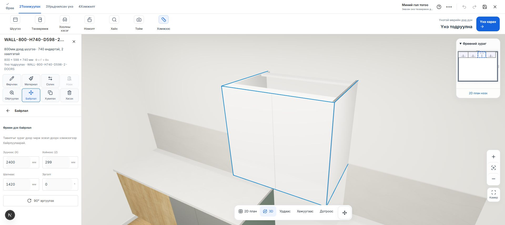

# Доод, дээд шүүгээний ангиллын засвар — 2026-10-24

Хэрэглэгчийн зураг, тайлбарын дагуу зүүн талын 1000 мм загвар нь доод шүүгээ; баруун талын 800 мм, 740 мм өндөртэй загвар нь дээд шүүгээ.

800 мм загвар Supabase каталогт `BASE-800-H740-D598` гэж бүртгэгдсэн байв. Зөвхөн тухайн нэг загвартай модулийн төрлийг `wall`, кодыг `WALL-800-H740-D598`, variant кодыг `WALL-800-H740-D598-2-DOORS` болгож, нэрийг дээд шүүгээ гэж тодруулав. Бодит 800 × 740 × 598 мм хэмжээс болон GLB файлыг өөрчлөөгүй. 1000 мм загвар `base` хэвээр.

Өөрчлөлтийн өмнөх ба дараах бүртгэлийг буцааж уншин баталсан. Скрипт нь нэг загвартай, зөв хэмжээтэй модуль мөн эсэхийг шалгаж нөөцөлнө. Variant код нь модулийн кодтой таарах ёстой өгөгдлийн сангийн шалгалттай тул модуль → variant → загварын нэр гэсэн дарааллаар шинэчилдэг. Алдаа гарвал өмнөх утгуудыг сэргээнэ. Schema, RLS болон эрхийг өөрчлөөгүй.

Хуучин төслийн засвар: каталогийн variant дээр `catalogRoleCorrection: {from: "base", to: "wall"}` гэсэн тодорхой тэмдэглэгээ байгаа, мөн SKU болон бүх хэмжээс таарсан тохиолдолд хадгалсан боксыг дээд шүүгээ болгон танина. Материал, өнгө, ID, хэмжээсийг хадгална. Ханын ойролцоох байрлалыг наалдуулж, автомат өндрийг тооцоод, доод шүүгээний worktop/plinth component-ийг хасна. Холбоогүй, хэмжээг нь өөрчилсөн эсвэл тэмдэглэгээгүй буруу SKU-г дур мэдэн өөр төрлөөр солихгүй.

Баталгаажуулалт:

- Нээлттэй хэрэглэгчийн дөрвөн бокстой төсөл дээр гурван 1000 мм доод шүүгээ, нэг 800 мм дээд шүүгээ зөв танигдсан.
- Дээд шүүгээний UI дахь шалнаас өндөр **1420 мм**, хананаас төвийн зай **299 мм** болсон.
- Каталогийн Доод / Дээд шүүлтүүрүүд зөв загвараа харуулсан. API дахь GLB validation алдаагүй.
- 1080/1080 тест, TypeScript, өөрчилсөн TS файлуудын ESLint амжилттай. Browser console алдаагүй.

Каталогийн өгөгдөл Supabase дээр шинэчлэгдсэн. Хуучин төслийг засах frontend код localhost дээр; commit, push, deployment хийгээгүй.
