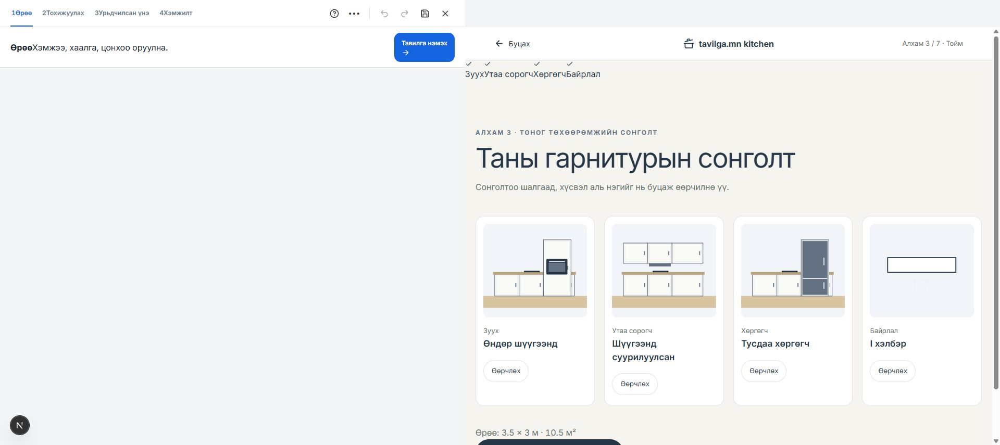
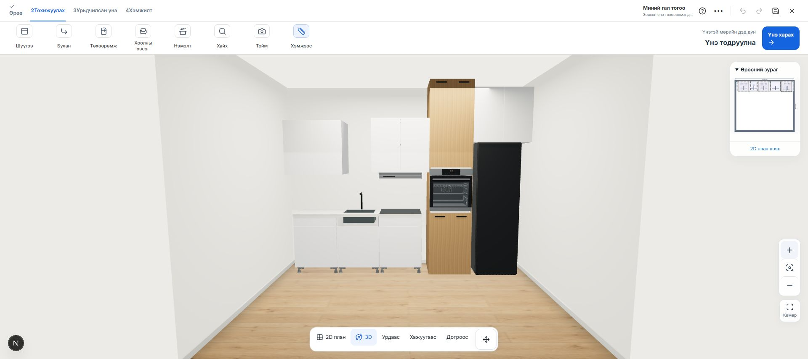

# Дөрвөн сонголтоос гал тогооны 3D загвар үүсгэх

Огноо: 2026-10-25

Зуух, сорогч, хөргөгч, байрлалын сонголтоо дуусгаад **«Гал тогооны загвар үүсгэх»** дарахад тухайн сонголтоор шинэ загвар үүсэж 3D засварлагч нээгдэнэ. Алхмуудыг үзэж шилжих үед одоогийн загварыг өөрчлөхгүй. Үүсгэх үйлдлийг Undo-оор буцааж болно. Өрөөний хэмжээ, нээлхий, тавцан, материал хадгалагдана. Багтахгүй бол өмнөх загварыг хадгалж, тайлбар харуулна.

- Тавцангийн доорх зуух болон өндөр box-д байрлах зуух тусдаа байрлалтай.
- Шүүгээнд суурилуулсан сорогч бодит дээд box-ийн доор; хананд ил сорогч тусдаа металл бүрхүүлтэй.
- Тусдаа хөргөгч PC Mall сангийн хэмжээс бүхий 3D загвараар орно. Суурилуулдаг хөргөгчийг тусдаа сонголтоор хадгална.
- I, L, U, хоёр талт хэлбэр сонгосноор ханын дагуух байрлал өөрчлөгдөнө. Бага өрөөнд сонгосон төхөөрөмжүүдийг багтаахын тулд нэмэлт хадгалах шүүгээг цөөлж болно.
- Загварыг дахин нээхэд суурилуулалтын төрөл болон сонголтууд хадгалагдана.

## Сангийн хязгаар

Санд өндөр зуухны box, суурилуулдаг хөргөгчийн үйлдвэрлэгчийн GLB байхгүй тул тэдгээрийн box-ийг параметрээр үүсгэнэ. Өндөр зуухны box-д санд байгаа зуухны GLB орно. Суурилуулдаг хөргөгчийн төхөөрөмжийг тусад нь сонгох шаардлагатай гэж тодорхой тэмдэглэсэн; санд байгаа тусдаа хөргөгчийг суурилуулдаг мэт орлуулж тооцохгүй. PC Mall загварууд нь төлөвлөлтөд зориулан бүтээсэн хэмжээс бүхий загвар, үйлдвэрлэгчийн CAD биш.

## Баталгаажуулалт

- 72 төрлийн сонголт × 2 өрөөний хэмжээ = 144 хослол: сонголтын хадгалалт, төрөл, байрлалын зөрчил шалгасан.
- Нийт автомат тест: **1,135 passed, 0 failed**.
- Typecheck, ESLint: амжилттай.
- Production build: амжилттай.
- Browser: 3500 × 3000 × 2700 мм тусдаа шалгалтын төсөлд өндөр зуух + далд сорогч + тусдаа хөргөгч + I хэлбэр сонгож, тоймоос шууд 3D загвар үүсгэсэн. Reload хийсний дараа яг тэр загвар хадгалагдсан. Console error илрээгүй.
- Localhost дээр шалгасан; production сайт руу deploy хийгээгүй.

