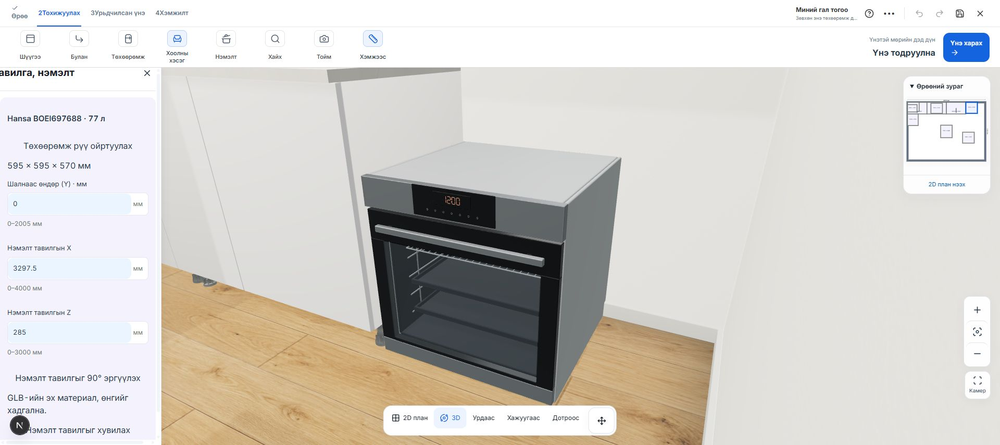
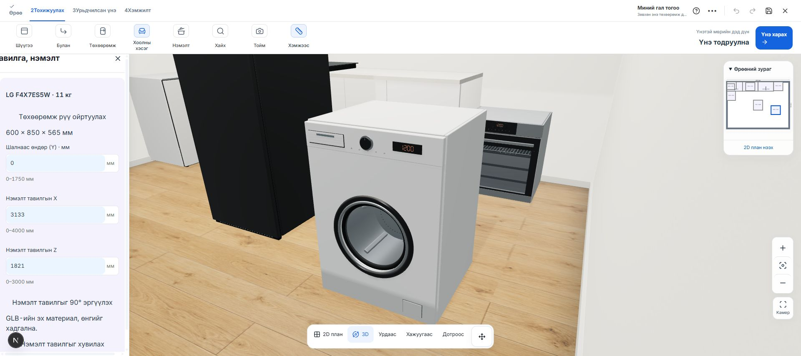

# PC Mall төхөөрөмжийн 3D чанар

2026-10-25. IKEA зуухны хэрэглэгчийн өгсөн жишээнд тулгуурлан локал kitchen planner-ийн 7 төхөөрөмжийн загварыг шинэчилсэн.

## Харагдах өөрчлөлт

- Зуух: хөндий камер, гүнтэй төмөр тор, хоёр тавиур, хажуугийн зам, арын сэнсний сараалж, нэвт харагдах бараан шил, ган хүрээ, бариул, геометрээр хийсэн дэлгэц ба удирдлага.
- Угаалгын машин: урд хавтангийн бодит дугуй нүх, хөндий ган хүрд, дотор хутгуур, резин жийргэвч, муруй шил, дугуй сонгогч, угаалгын бодисны шургуулга.
- Богино долгионы зуух: хөндий камер, хэвтээ эргэдэг таваг, шил ба нарийн торон хаалт.
- Плитка, сорогч, хөргөгч, аяга таваг угаагч: зөөлөн ирмэг, материалын ялгаа, бариул/завсар/сараалж болон удирдлагын жижиг хийц.
- Төхөөрөмжийн тохиргоонд **Төхөөрөмж рүү ойртуулах** товч нэмсэн. 2D-оос 3D рүү шилжин сонгосон төхөөрөмжийг хүрээлж харуулна. Canvas хэмжигдээгүй үед камерын хүсэлтийг алгасаж дуусгахгүй хүлээнэ.

## Үндсэн засвар

RoundedBoxGeometry-ийн smooth normal-уудыг дараа нь computeVertexNormals() дуудаж хавтгайруулдаг байсан. Одоо хэмжээ/байрлалын матрицыг geometry.applyMatrix4() ашиглан хувиргаж, эх normal-уудыг хадгална. Шилэн хэсэг камерын доторх хийцийг далдлах битүү сүүдэр үүсгэхгүй. Зуухны доод ган хүрээ ба хар хажуу хүрээний давхцлыг арилгасан.

Загварууд `public/models/pcmall/quality-v2/` дотор байрлана. Өмнөх хадгалсан төслийн product/model ID, хэмжээ, байрлал хадгалагдана. Хуучин браузерын кэшээс ялгахын тулд URL замыг хувилбарласан.

| Төрөл | Mesh | Triangle | GLB byte |
| --- | ---: | ---: | ---: |
| Хөргөгч | 6 | 3,216 | 104,872 |
| Зуух | 18 | 42,450 | 1,146,408 |
| Плитка | 3 | 19,728 | 477,384 |
| Сорогч | 5 | 10,920 | 334,276 |
| Богино долгионы зуух | 11 | 13,074 | 414,668 |
| Аяга таваг угаагч | 8 | 8,316 | 233,896 |
| Угаалгын машин | 19 | 37,884 | 1,140,884 |

Нийт 3.85 MB орчим. Материал ба зориулалтаар mesh-үүдийг нэгтгэсэн. Дотор хийц нь жинхэнэ 3D геометр; бүтээгдэхүүний зургийг нүүрэн дээр наагаагүй. Каталогийн зураг зөвхөн сонголтын картанд ашиглагдана.

Эдгээр нь нийтлэгдсэн гадна хэмжээтэй төлөвлөлтийн загварууд. Үйлдвэрлэгчийн албан CAD биш; жижиг хийц, удирдлага нь ойролцоо дүрслэл. Тусдаа төхөөрөмжөөр байрлана; шүүгээнд суулгах нүхийг автоматаар гаргах ажиллагаа энэ өөрчлөлтөд ороогүй.

## Шалгалт

- Бүх 1,099 тест тэнцсэн: `pcmall-quality-all-tests-2026-10-24.log`.
- Шинэ GLB тестүүд: 7 төхөөрөмжийн гадна хэмжээ, эх сурвалжийн metadata, smooth/unit normal, гэрэл нэвтрүүлэх шил, торны бодит гүн, зураггүй материал, хадгалсан төсөл ба байршуулалтын нийцэл.
- ESLint болон TypeScript шалгалт тэнцсэн.
- Chrome дээр локал 7 төхөөрөмжтэй төслийн зуух, угаалгын машиныг 2D-оос нэг даралтаар ойртуулан шалгасан.
- Production build амжилттай (exit 0): `pcmall-quality-build-2026-10-25.log`.

## Бодит browser зураг

Локал өөрчлөлт. Commit, push, production deploy хийгээгүй.
