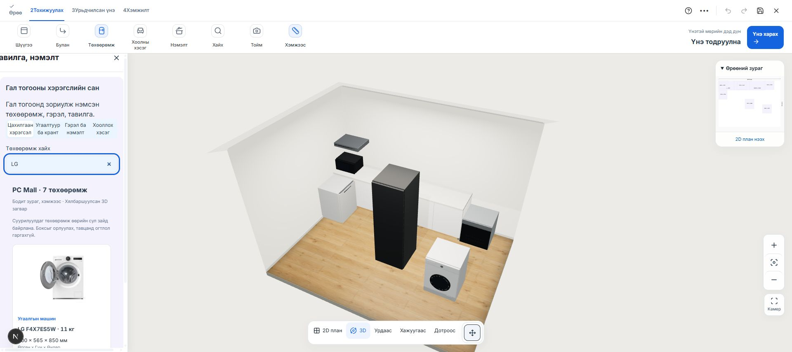
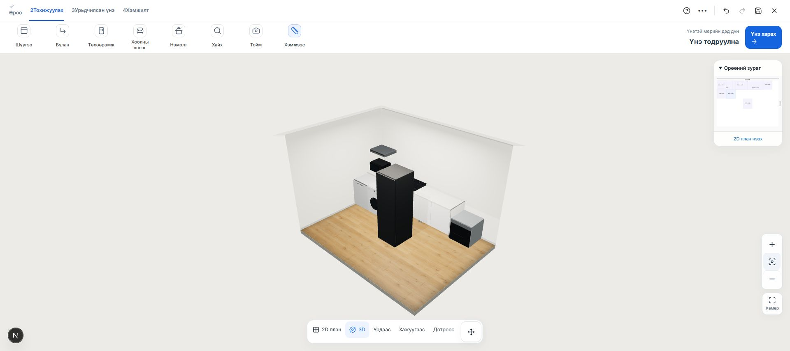

# PC Mall — гал тогооны 7 төхөөрөмж

2026-10-24. Хэрэглэгчийн сонгосон хүрээ: гал тогооны долоон төрлөөс тус бүр нэг. Local planner-ийн **Төхөөрөмж → Цахилгаан хэрэгсэл → PC Mall** хэсэгт нэмэв. Нийтэд deploy хийгээгүй.

| Төрөл | Бараа / эх сурвалж | Өргөн × Гүн × Өндөр, мм |
|---|---|---|
| Хөргөгч | [Samsung RR80H39C1FWT](https://pc-mall.mn/products/17866920675034) | 595 × 644 × 1858 |
| Шарах шүүгээ | [Hansa BOEI697688](https://pc-mall.mn/products/17834239740464) | 595 × 570 × 595 |
| Тавцангийн плитка | [Hansa BHC60066](https://pc-mall.mn/products/17834239702084) | 592 × 522 × 47 |
| Хиншүү сорогч | [Hansa OSP6111SIH](https://pc-mall.mn/products/17386945366444) | 598 × 470 × 85 |
| Богино долгионы зуух | [Samsung MS23K3513AK/BW](https://pc-mall.mn/products/17509361296161) | 489 × 379 × 275 |
| Аяга таваг угаагч | [Samsung DW70H73WCB0WT](https://pc-mall.mn/products/17866921088194) | 598 × 550 × 815 |
| Угаалгын машин | [LG F4X7ES5W — хэрэглэгчийн явуулсан бараа](https://pc-mall.mn/products/17846953431104) | 600 × 565 × 850 |

Барааны нэр, нийтэд нээлттэй зураг, гадна хэмжээг эх хуудсуудын үзүүлэлтээс авсан. Үнийг 2026-10-24-ний **лавлах үнэ** гэж тусад нь харуулна; худалдааны баталгаатай үнэ, өөрийн дэлгүүрийн quote subtotal болгон ашиглахгүй. Хөргөгч эх дэлгүүрт үлдэгдэлгүй байсныг тэмдэглэсэн; зурагт төлөвлөх боломжтой.

## 3D загвар

Эх хуудсуудад татах GLB/OBJ холбоос харагдаагүй. `public/models/pcmall/` доторх GLB нь хэмжээсээр нь өөрсдөө хийсэн **хялбаршуулсан төлөвлөлтийн дүрслэл**. Үйлдвэрийн CAD, суурилуулалтын баталгаатай зураг биш. Урд талын геометр нь зурагтайгаа яг адил биш.

- Бодит гадна хэмжээтэй, доод төв origin, метр нэгжтэй. Нүүр, бариул, удирдлага, угаалгын машины дугуй хаалга, плитканы дөрвөн бүс зэрэг геометртэй.
- GLB-үүд 119–888 KB, нийт ойролцоогоор 3.1 MB. Дүрслэлд үйлдвэрлэгчийн бэлэн файл гэж тэмдэглээгүй.
- `node scripts/models/build-pcmall-appliances.mjs` — GLB/manifest дахин үүсгэх; `--download-images` — эх зургуудыг татах.
- Өгөгдөл: `src/lib/pcmallAppliances.ts`. Эх хуудасны нотолгоо: `pcmall-appliance-evidence-2026-10-24.json`.

## Байрлуулах ба хадгалах

Долоон төхөөрөмжийг нэмэх, сонгох, байрлал/өндөр/эргэлт өөрчлөх, хувилах, хасах боломжтой. Шалны төхөөрөмж өөрийн сул эзлэхүүнд, сорогч хананд, плитка/печь бодит тавцангийн дээр байрлана. Тавцан дээр хэд хэдэн төхөөрөмж байрлуулах сул зайг хайна; салгасан тавцангийн байрлал, эргэлтийг дагана.

Суурилуулдаг төхөөрөмжийг одоо байгаа боксын geometry руу шингээж оруулахгүй, хаалгыг нь автоматаар авахгүй, тавцанд нүх гаргахгүй. Суурилуулалтын огтлол/тавилгын эд ангийг тусад нь тааруулна. Каталогт энэ хязгаарыг харуулсан.

Өмнө нь төхөөрөмж нэмсний дараах selection нь render-ийн хуучин design-оос төрлөө шалгадаг байсан тул хоосон самбар нээгдэж байв. Одоо commit хийсэн шинэ design ref-ээс шалгана.

## Баталгаажуулалт

- Бүх үндсэн тест: 1095 / 1095 PASS (`pcmall-all-tests-2026-10-24.log`).
- Сүүлийн UI/хайлтын нэмэлт шалгалттай focused run: 16 / 16 PASS (`pcmall-final-tests-2026-10-24.log`).
- TypeScript, ESLint, production build PASS.
- GLTFLoader-оор долоон GLB-г задлан хэмжээс, доод origin, үйлдвэрлэгчийн CAD биш гэсэн metadata шалгасан.
- Chrome-д 3 доод шүүгээтэй тусдаа draft дээр долоон төхөөрөмжийг тус бүр нэгээр нэмж, console error байхгүйг шалгасан. Дахин ачаалахад долоон нэр, хэмжээ, байрлал хадгалагдсан. LG хайлт зөв шүүсэн.
- Хэрэглэгчийн үндсэн өрөөний байрлал, материалыг өөрчлөөгүй.

