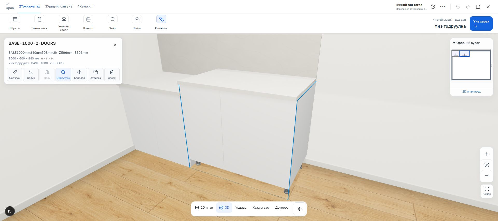
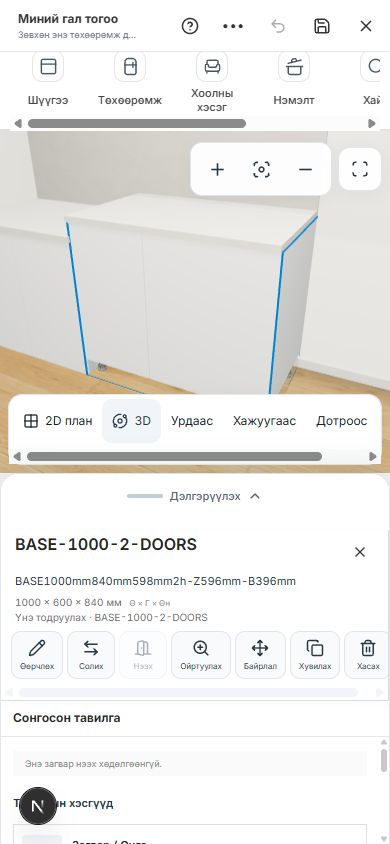

# Room / Kitchen Planner — 3D дүрслэл ба интерфэйсийн засвар

Огноо: 2026-10-22. IKEA-ийн хэрэглэгчээс өгсөн screenshot-ийг харагдацын чиглэл болгон ашиглав.

## Зассан шалтгаанууд

- Каталогийн бодит `BASE-1000` GLB-ийн хоёр нүүр болон арын хавтанд материал оноогоогүй байсан. Three.js-ийн glTF default нь metalness=1, roughness=1 тул цагаан хавтан саарал металл шиг харагдаж байв. Parser-ийн material association-оор зөвхөн оноогоогүй default материалыг ялгаж, саармаг цагаан будгийн fallback хэрэглэв. Зориуд тохируулсан металл, зураг, normal, roughness хэвээр.
- Kitchen scene-ийн орчны ойлт болон нэгдсэн renderer тохиргооны холбоос дутуу байсныг сэргээв. Өрөөний доторх зөөлөн гэрэл, шалтай хүрэлцэх сүүдэр нэмэв.
- GLB-ийн урд болон их биеийн материал, угсралтын хэсгийн materialId дамжуулалтыг сэргээв. Текстур ачаалах алдаа болон GPU материалын давхардсан clone/dispose-ийг засав.
- Чадалтай төхөөрөмжийн DPR дээд хязгаарыг 2 болгож, камер хөдөлгөхөд desktop-ийн ирмэгийг 1 CSS пикселээс доош буулгахаа болив. Бага чадалтай төхөөрөмжийн хязгаар хэвээр. Texture filtering нь GPU-ийн дэмжлэгээр хязгаарлагдана; alpha-mask MSAA нь шилний transparency-г өөрчлөхгүй.
- Тавцангийн хэт тод долгионт хээг нарийн, бага ялгаралтай чулуун хээгээр шинэчлэв.
- Desktop-д сонгосон тавилгын 7 үйлдлийг авсаархан хөвөгч картад байрлуулав. Дэлгэрэнгүй засвар тусдаа drawer-аар нээгдэнэ. Room planner-ийн карт, zoom болон хоёр цэсийн байрлалыг засав.
- Lazy editor шинэчлэгдэхэд CSS тасарч, thumbnail бүтэн дэлгэц дүүргэдэг доголдлыг route layout-аас хэв загварыг урьдчилан ачаалж засав.
- Амжилтын мэдэгдэл 4.5 секундийн дараа хаагдана. Алдааны мэдэгдэл өөрөө алга болохгүй.

## Баталгаажуулалт

- `npm test`: **1,061 / 1,061 тэнцсэн**.
- `npm run build`: **амжилттай**, lint болон TypeScript шалгалт багтсан.
- Нэмэлт lint, TypeScript болон renderer-ийн сонгосон тестүүд тэнцсэн.
- Браузерт бодит каталогийн 800 мм болон 1000 мм GLB-ийг нэмэх, 2D-ээс сонгох, 3D рүү шилжих, ойртуулах, сонголтын карт болон кодын шинэчлэлтийн дараах CSS-ийг шалгав.
- 390 × 844 утасны харагдац: хуудасны хэвтээ overflow байхгүй; 3D цонх 390 × 343, сонгосон тавилгын bottom sheet ажилласан. Дараа нь viewport-ийг хэвийн хэмжээнд буцаасан.
- Өрөөний planner-ийн эхлэх дэлгэц, өмнөх төслийг нээх удирдлага ажилласан.
- Git merge зөрчил байхгүй. Өөрчлөлтүүд локал workspace-д; remote push болон deployment хийгээгүй.

## Харагдац

Логууд: `planner-quality-all-tests-2026-10-22.log`, `planner-quality-build-2026-10-22.log`.
